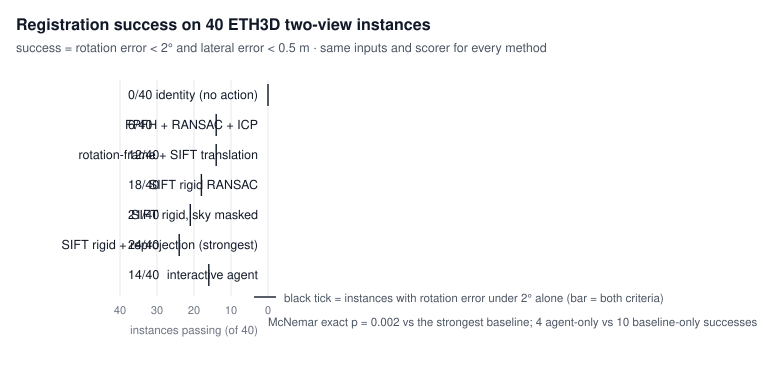

# MV-Recon — can an LLM drive an interactive 3D workbench to register sparse views?

Answer as measured on ETH3D: **yes, it can operate the bench competently, but it does not
beat a strong classical two-view pipeline.** On 40 registration instances (19 unique view
pairs, 7 scenes) the agent reached **14/40** successes against **24/40** for
SIFT-rigid + reprojection refinement under identical inputs and scoring
(McNemar exact p = 0.002; no success the baseline did not also get). Median errors are close
(2.36° / 0.26 m vs 1.93° / 0.29 m) and the agent's catastrophic tail is shorter, but that is
not a success gain.



Full report: [`out/agent_study_20261123/report/SUMMARY.md`](out/agent_study_20261123/report/SUMMARY.md).

## What was tested

Each task is one pair of views of a real ETH3D scene. The moving view's cloud is put at a
deliberately wrong injected pose D (25–66° rotation, metre-scale translation) and the agent
must bring it onto the reference view through a command-line workbench:

| tool group | commands |
|---|---|
| look | `photos`, `photo`, `render` (iso/top/side/…), `closeup` |
| correspond | `match` (SIFT/ORB/AKAZE, optional pixel boxes) |
| solve | `solve translation\|rigid3d\|rotcorr\|reproj`, `icp`, `fpfh` |
| edit | `rotate`, `translate`, `mask`, `undo` |
| decide | `finish --status done\|abstain` |

Budget 30 charged operations. Every state change is logged as an exact increment matrix, and
the scorer **replays the trace** and refuses to score a case unless the replay reproduces the
saved final transform to 1e-8 (40/40 passed). The agent never saw ground-truth poses; a
leakage audit over every tool input, `Read` path, Bash command and assistant message passed
39/40 — the one exception ran an inline numpy matrix product outside the CLI (no GT, no
external data; metrics unchanged if excluded).

## Headline result (40 instances, full set, no GT filtering)

| method | median rot | median lateral | under 2° & 0.5 m | unique pairs |
|---|---|---|---|---|
| identity (injected D, no action) | 57.95° | 1.93 m | 0/40 | 0/19 |
| FPFH + RANSAC + ICP | 4.57° | 2.93 m | 6/40 | 3/19 |
| rotation-frame + SIFT translation | 4.57° | 0.43 m | 12/40 | 5/19 |
| SIFT rigid RANSAC | 2.14° | 0.33 m | 18/40 | 7/19 |
| SIFT rigid, sky masked | 1.95° | 0.33 m | 21/40 | 8/19 |
| **SIFT rigid + reprojection refinement** | **1.93°** | **0.29 m** | **24/40** | **10/19** |
| interactive agent (Claude Sonnet 5) | 2.36° | 0.26 m | 14/40 | 5/19 |

Paired against the strongest baseline: rotation Δ median −0.11° (Wilcoxon p = 0.29), lateral
Δ median +0.0003 m (p = 0.74) — statistically indistinguishable in magnitude — but
4 agent-only vs 10 baseline-only successes. The agent passes fewer cases on rotation
(16 under 2° vs 24) while passing slightly more on lateral (29 under 0.5 m vs 27): it is
close but not precise enough on orientation, which is the binding constraint on these data.

## What the agent actually did

- 37/40 sessions are SIFT → rigid 3D → ICP; 2 start from FPFH. The numbers are made by the
  classical tools; the model contributes *selection* — which view region to match, when a
  refinement has made things worse, when to stop. Only 3/40 final matrices coincide with
  any baseline exactly.
- Extra rounds against its own first solver output are neutral (rotation improved 18, worsened
  15; median Δ ≈ 0).
- 2 abstentions (logged reasons): `electro_v4_0092` — no real overlap between the views, so it
  restored the initial state; `playground_v4_0278` — the point cloud's pitch distortion
  contradicts the image geometry, so it kept a tentative transform but did not claim completion.
- Where it helps: it avoids the baseline's catastrophic miss on `facade_v4_0201`
  (7.7° / 1.5 m vs 73.9° / 31.7 m). Where it hurts: office, courtyard 0008, facade 0169.

## Reproduce

See [`study/README.md`](study/README.md). Short version (sandbox under `%TEMP%`; nothing is
written into this repository):

```powershell
python study/prepare_study.py          # build the 40-case sandbox
python study/baselines_full.py         # 9 baselines x 40 instances
# launch one Agent-tool subagent per case (study/full_run_workflow.js); then:
$env:MVREBENCH_SUBAGENTS = '<run>/subagents'
python study/collect_agents.py
python study/audit_leakage.py out/agent_study_20261123/raw/transcripts out/agent_study_20261123/eval/leakage_audit.json
python study/score_study.py            # replay-verified scoring
python study/stats_tests.py; python study/attribution.py; python study/make_report.py
```

The workbench used for the 40 runs is the frozen `out/agent_study_20261123/raw/workbench_cli_frozen.py`
(SHA-256 `2c67867a…ccd1d`); `study/workbench_cli.py` is the later working copy and hashes
differently. Baseline and agent scoring both go through `eval/protocol.py`.

## Data provenance — read before reusing

- **Input clouds.** Each view's cloud was produced by a frozen mono-depth model, not by
  reprojecting a real scan. This result therefore measures *registration given a fixed
  two-view input pair*, not mono-depth quality; see `STATUS.md` and `COORDINATE_AUDIT.md`.
- **Ground truth.** `eval_data/` holds per-scene GT annotations (intrinsics, camera poses)
  and `task.json` / `gt_transforms.json` with `T_true`. Task construction and scoring use
  them; the sandbox the agents ran in did not contain them, and the leakage audit is what
  checks that.
- **Real-geometry arm.** ETH3D's registered laser scans (tiles download, `occlusion/surface_mesh.ply`)
  were obtained for 4 of the 7 scenes and local view clouds with visibility/occlusion were
  built from them (`study/build_real_local_clouds.py`), plus a visibility-graph grouping into
  high / low / bridge / unconnected pairs (`study/visibility_graph.py`, logs in
  `study/real_meta/`). **That arm has not been run through the workbench or scored** — it is
  draft scaffolding, not part of the headline numbers.
- **ETH3D imagery** is not redistributed here. Download it from <https://www.eth3d.net/>
  under its own licence.

## Layout

```
study/       sandbox builder, baselines, scoring, leakage audit, report generator, launcher
workbench/   earlier workbench implementation; bench/ and hpc/ are earlier experiment arms
eval/        protocol/scoring and the earlier rotation/translation analysis arms
eval_data/   GT annotations per scene + tasks + T_true (NOT for agents)
hpc/         CPU-partition match sweep (job 14069627) code and analysis
out/agent_study_20261123/
  eval/      agent_results, baselines, summary, stats, attribution, leakage audit, per-case CSV
  raw/       per-case transcripts, final messages, launches, frozen CLI, run manifest
  export/    offline 3D viewers per scene (no network needed)
  report/    SUMMARY.md
FINDING_*.md / STATUS.md   cumulative research log
```

## Caveats worth knowing

- The study is **two-view** registration from an injected wrong pose, with high direct
  overlap in most cases. The low-overlap and bridge tasks in the brief were only reached at
  the grouping stage (4 scenes), not executed.
- Dates on the research log (`FINDING_*.md`, `STATUS.md`) read 2026-11-23/24 — the clock of the
  machine that ran them.
